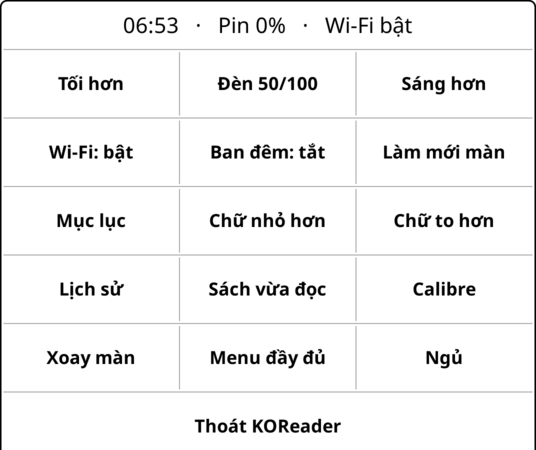
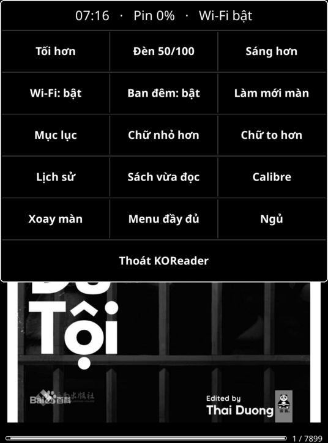
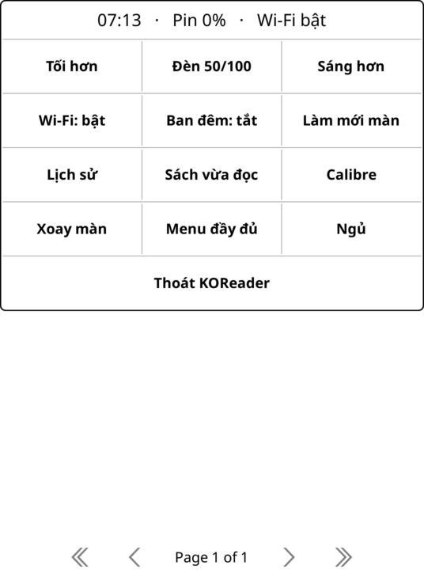

# Quick panel for KOReader

An Android-style quick settings sheet for [KOReader](https://github.com/koreader/koreader).
Swipe down from the top edge to open it. Tapping the top edge still opens the normal KOReader menu.

| Reading | Night mode | File browser |
|---|---|---|
|  |  |  |

Screenshots from the KOReader v2026.07.1 emulator at Kindle Paperwhite 4 resolution (1072×1448).

## What is on the panel

| | | |
|---|---|---|
| Dimmer | Light level (tap to toggle) | Brighter |
| Wi-Fi on/off | Night mode | Full refresh |
| Table of contents* | Smaller font* | Larger font* |
| History | Previous book | Calibre wireless |
| Rotate | Full menu | Sleep |
| Home folder | Exit KOReader | |

\* only while a book is open.

The title line shows the time, battery level and Wi-Fi state.
Brightness buttons update in place; every other button closes the panel and runs the action.
The interface text is Vietnamese.

## Install

1. Copy this folder to `koreader/plugins/quickpanel.koplugin` on the device
   (on a Kindle over USB: `<drive>:\koreader\plugins\quickpanel.koplugin`).
2. Restart KOReader.
3. Swipe down from the top of the screen.

Turn the swipe on or off under **Tools → Quick panel**. The action `quickpanel_show` is also
available to the gesture manager and profiles.

To uninstall, delete the folder and restart KOReader.

## Tested on

- KOReader v2026.07.1, Kindle Paperwhite 4 (10th gen, firmware 5.18.1.1.1), normal and no-framework mode.
- KOReader v2026.07.1 Linux emulator at 1072×1448 / 300 dpi: every button in the reader and the file browser,
  fast and slow swipes, tap outside to close (see `dev/emulator-test.sh`).

## Implementation notes

- The swipe and pan touch zones are registered with `overrides` for `readermenu_*` and `filemanager_*`
  so they run before the stock menu. ReaderMenu re-registers its zones in `onReaderReady`, and
  FileManagerMenu registers zones on itself, so the plugin registers on the same widget and again
  after the reader is ready.
- The panel's `MovableContainer` touch handlers are removed and the rest of the gesture is swallowed.
  Otherwise the finger that opened the panel keeps dragging it down, which repaints it many times
  over the page (slow on e-ink).
- Plugins receive a `dialog` field from KOReader that points at the main UI. The panel is stored in
  `_qp_dialog`; closing `self.dialog` closes KOReader itself and leaves a blank screen.
- "Open previous document" crashes KOReader when there is no previous document, so the plugin checks first.

## Development

`dev/emulator-test.sh` runs the official KOReader Linux build under Xvfb, opens a book, swipes down
and taps a button, then checks the log for errors. See the comments at the top of the script.

## License

AGPL-3.0, the same license as KOReader.
